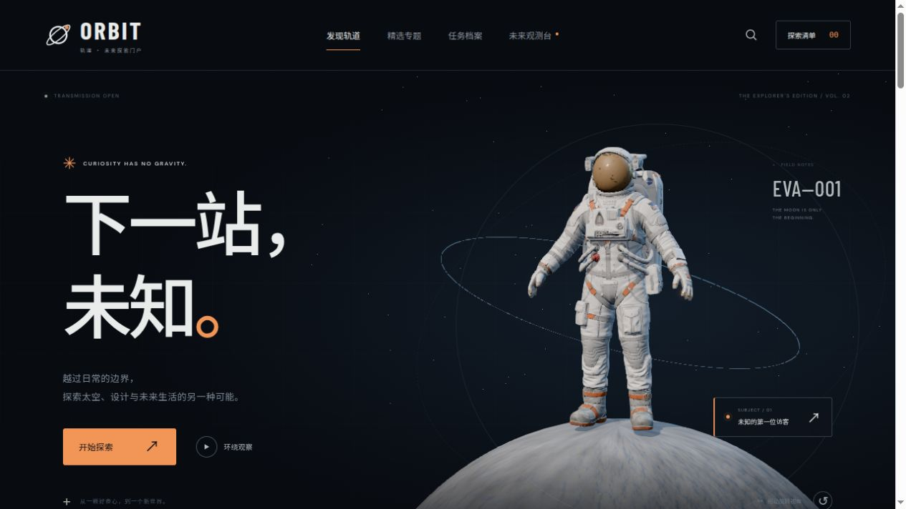

# ORBIT 轨道

以交互 3D 宇航员为主视觉的中文未来探索门户，使用 **Vite、Three.js 和 Dioramas 渲染核心**，支持纯静态部署。

**[在线演示](https://orbit-diorama-portal.bismihkuro.chatgpt.site/) · [素材署名](https://orbit-diorama-portal.bismihkuro.chatgpt.site/credits.html)**



## 功能

- 可拖动旋转的真实 3D 宇航员，环绕、近距及装备视角，加载海报和低动态偏好支持。
- 四篇完整专题、分类筛选、跨专题和任务搜索、三份概念任务档案。
- 地球、火星、深空主题，以及保存在本浏览器的探索收藏清单。
- 手机布局、键盘访问、详情弹窗与素材署名页。

品牌、文章和任务为虚构演示，不代表真实航天任务、新闻或招募。收藏不上传服务器。

## 运行与部署

需要 Node.js 22.12+。

```sh
npm ci
npm run dev
```

默认开发地址为 http://localhost:4173/ 。

```sh
npm run build
npm run preview
```

将 `dist/` 整体部署到静态托管服务的域名根路径，无后端或数据库。模型与图片随站点打包，字体从 Google Fonts 加载，网络不可用时使用系统字体。

## 源码

| 路径 | 用途 |
| --- | --- |
| `src/main.js` | 专题、搜索、收藏与页面交互 |
| `src/world.js` | 自定义宇航员场景与交互视角 |
| `src/core/` | Dioramas 渲染核心 |
| `src/style.css` | 响应式样式 |
| `public/models/`、`public/images/` | 模型、海报与图片 |
| `public/licenses/`、`public/credits.html` | 许可与署名 |

## 许可

新增页面、中文内容与交互代码采用 [MIT](LICENSE)。渲染核心基于 [Dioramas](https://github.com/blendi-remade/dioramas)，保留作者 Blendi 的 [MIT 许可](public/licenses/dioramas-MIT.txt)。

模型、原始图片及基于它们制作的海报遵循 **CC BY 4.0**，复用须保留 Dioramas 署名、许可链接并说明修改；这些资产不适用根目录的软件 MIT 许可。详见 [素材许可](public/licenses/ASSET-LICENSES.md)和 [第三方声明](public/licenses/THIRD_PARTY_NOTICES.md)。

源码可独立构建，不包含原 Sites 项目标识、发布凭据或账户配置。
